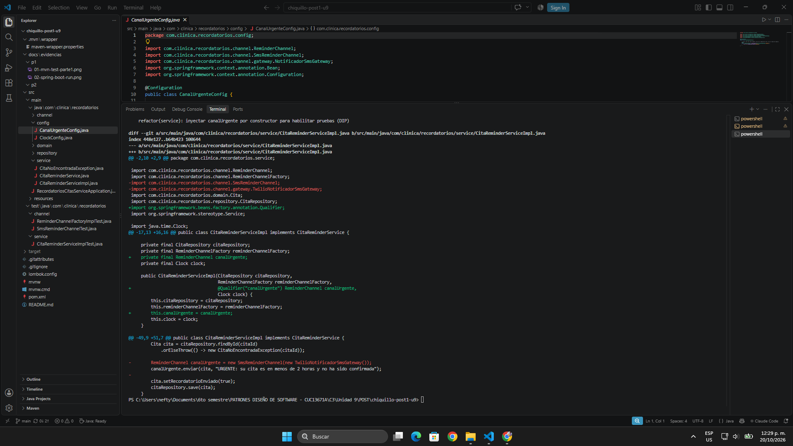
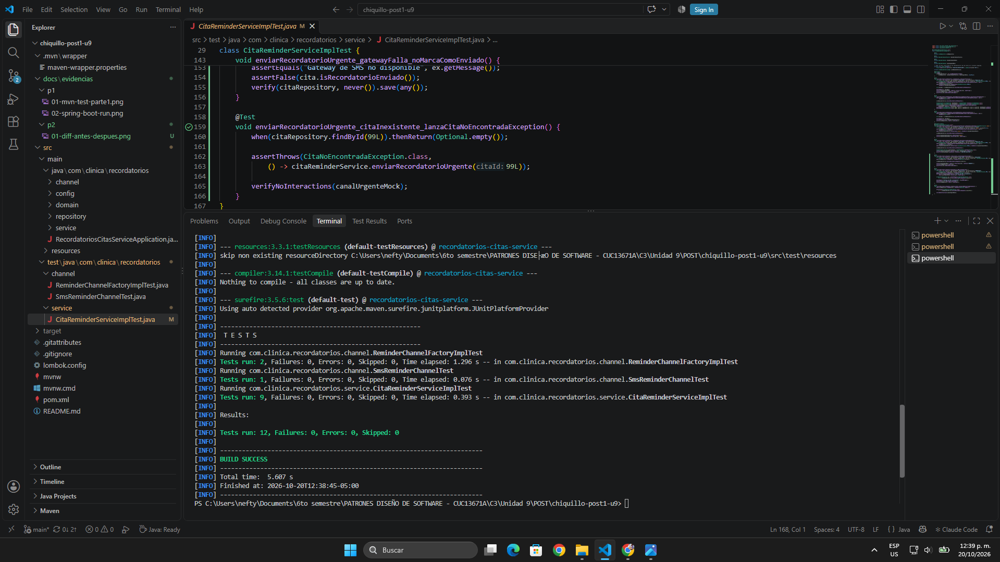
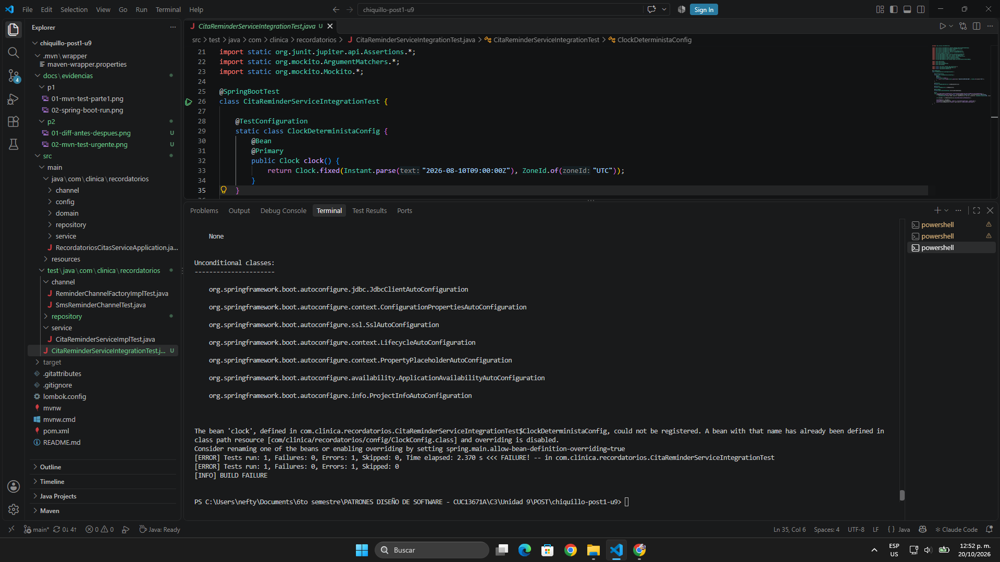
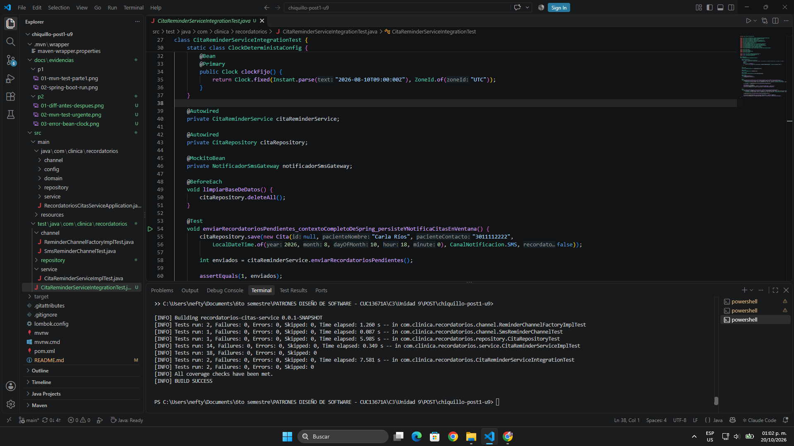
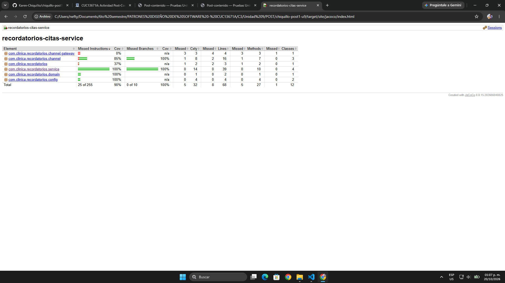
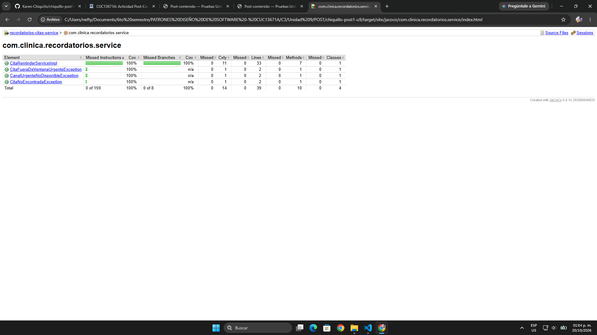
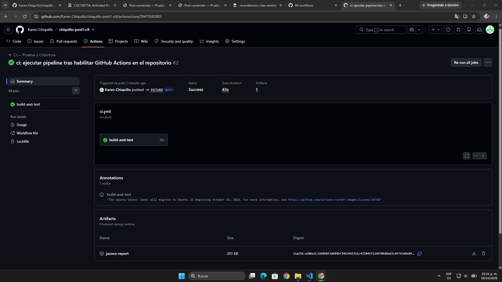

# Recordatorios Citas Service


## Descripción

Repositorio del post-contenido de la Unidad 9 de Patrones de Diseño de Software — Sexto Semestre. Contiene un único proyecto Spring Boot (`recordatorios-citas-service`) que revisa qué citas médicas ocurren dentro de las próximas 24 horas y todavía no han sido notificadas, y le envía al paciente un recordatorio por su canal preferido (correo o SMS) sobre una base de datos H2 en memoria.

El servicio central, `CitaReminderServiceImpl`, está construido desde el inicio con dos patrones de unidades anteriores y recibe sus tres colaboradores por constructor (DIP): **Strategy** (`ReminderChannel`, Unidad 4), donde cada canal de envío es una implementación intercambiable del mismo método `enviar(cita, mensaje)`, y **Factory Method** (`ReminderChannelFactory`, Unidad 2), que decide qué canal entregar según `cita.getCanalPreferido()`. El tercer colaborador es un `Clock`, que se registra como bean en `config/ClockConfig` para que la hora actual también sea una dependencia inyectada.

El proyecto usa Spring Boot 3.5.16 en lugar del 3.3.x que indica la guía, porque Spring Initializr ya no ofrece la línea 3.3.

---

## Parte 1 — Pruebas Unitarias con JUnit 5 y Mockito

`CitaReminderServiceImplTest` aísla `CitaReminderServiceImpl` de sus tres colaboradores con `@ExtendWith(MockitoExtension.class)`, sin levantar el contexto de Spring: `CitaRepository`, `ReminderChannelFactory` y `ReminderChannel` son dobles de Mockito, y el `Clock` es `Clock.fixed(...)` congelado en `2026-08-10T09:00:00Z`. La justificación de cada doble está en *Decisiones de diseño*.

Además de las tres pruebas de la guía, se agregaron pruebas para lo que la guía describe pero no prueba: la selección de canal para EMAIL **y** SMS, el contenido del mensaje, la Factory real y la estrategia SMS. Los paquetes de prueba repiten los de la aplicación (`service/` y `channel/`).

| Clase | Prueba | Qué verifica |
|-------|--------|--------------|
| `CitaReminderServiceImplTest` | `enviarRecordatoriosPendientes_citaEnVentana_usaElCanalPreferido` | La cita se envía por el canal que entrega la Factory, se guarda una vez y queda con `recordatorioEnviado = true`. |
| | `enviarRecordatoriosPendientes_ventanaDeterministaSegunClockFijo_consultaLosLimitesExactos` | Con el `Clock` fijo, el repositorio se consulta exactamente entre las 09:00 del 10 y las 09:00 del 11 de agosto. |
| | `enviarRecordatoriosPendientes_sinCitasPendientes_noConsultaLaFactory` | Sin citas no se pide ningún canal ni se llama a `save`. |
| | `enviarRecordatoriosPendientes_cualquierCanalPreferido_pideALaFactoryEseCanal` | `@ParameterizedTest` con `@EnumSource`: para EMAIL y para SMS se verifica `obtenerCanal(canal)`. |
| | `enviarRecordatoriosPendientes_citaEnVentana_mensajeIncluyeFechaDeLaCita` | Un `ArgumentCaptor` sobre el mensaje comprueba que incluye la fecha de la cita. |
| `ReminderChannelFactoryImplTest` | `obtenerCanal_email_retornaEmailReminderChannel` / `obtenerCanal_sms_retornaSmsReminderChannel` | La Factory real devuelve la misma instancia de cada estrategia (`assertSame`). |
| `SmsReminderChannelTest` | `enviar_citaConTelefono_delegaAlGatewayConContactoYMensaje` | `SmsReminderChannel` llama al gateway con el teléfono del paciente y el mensaje. |

Al terminar la Parte 1, `mvn test` ejecutaba **9 pruebas** (8 métodos; la parametrizada corre una vez por canal) con 0 fallos.

Las pruebas corren sin advertencias. Con JDK 21 y la configuración por defecto, cada `mvn test` mostraba `Mockito is currently self-attaching...` y `WARNING: A Java agent has been loaded dynamically`; por eso en el `pom.xml` Surefire carga Mockito como `-javaagent` (con `-Xshare:off`), y en `application.properties` se definió `spring.jpa.open-in-view=false` para quitar el aviso de Spring al arrancar.

---

## Parte 2 — Refactor DIP, Integración y CI/CD

`enviarRecordatorioUrgente(Long citaId)` nació con un `new SmsReminderChannel(new TwilioNotificadorSmsGateway())` dentro del método, que lo hacía imposible de probar en aislamiento. El refactor movió ese `new` a `config/CanalUrgenteConfig.java` e inyectó la abstracción `ReminderChannel` por constructor con `@Qualifier("canalUrgente")`. `CitaRepositoryTest` (`@DataJpaTest`) y `CitaReminderServiceIntegrationTest` (`@SpringBootTest`) prueban la persistencia y el flujo completo con H2 y un `Clock` fijo, y el pipeline `.github/workflows/ci.yml` ejecuta `mvn verify` en cada push a `main` y publica el reporte de JaCoCo.

| Clase | Prueba | Qué verifica |
|-------|--------|--------------|
| `CitaReminderServiceImplTest` | `enviarRecordatorioUrgente_citaExistente_usaCanalUrgenteInyectado` | El canal urgente inyectado recibe un mensaje con "URGENTE", la cita se guarda y queda enviada. |
| | `enviarRecordatorioUrgente_gatewayFalla_noMarcaComoEnviado` | Si el canal lanza una excepción, la cita **no** queda marcada como enviada y no se llama a `save`. |
| | `enviarRecordatorioUrgente_citaInexistente_lanzaCitaNoEncontradaException` | Un id inexistente lanza la excepción de negocio y el canal no se usa. |
| | `enviarRecordatorioUrgente_citaFueraDeVentanaDeDosHoras_lanzaCitaFueraDeVentanaUrgenteException` | `@ParameterizedTest` con 09:00 (ahora), 08:00 (pasada) y 11:01 (fuera del límite): no se envía ni se guarda. |
| | `enviarRecordatorioUrgente_citaJustoADosHoras_enviaRecordatorio` | A las 11:00 exactas (límite incluido) sí se envía. |
| | `enviarRecordatorioUrgente_pacienteConCanalEmail_lanzaCanalUrgenteNoDisponibleException` | A un paciente con correo no se le envía un SMS. |
| `CitaRepositoryTest` | `findByFechaHoraCitaBetweenAndRecordatorioEnviadoFalse_soloRetornaCitasPendientesEnVentana` | Con H2, la consulta devuelve exactamente 1 cita: excluye la ya enviada y la que está fuera de la ventana. |
| `CitaReminderServiceIntegrationTest` | `enviarRecordatoriosPendientes_contextoCompletoDeSpring_persisteYNotificaCitasEnVentana` | Con el contexto completo, la cita SMS se notifica por el gateway y queda guardada como enviada. |
| | `enviarRecordatorioUrgente_contextoCompleto_usaBeanCanalUrgenteConGatewayMockeado` | El bean `canalUrgente` de `CanalUrgenteConfig` quedó conectado al gateway. |

`mvn test` ejecuta **18 pruebas** (unitarias y de repositorio) y `mvn verify` agrega las **2 de integración**, todas con 0 fallos. El reporte de JaCoCo da **60 de 68 líneas cubiertas (88,2 %)**, 90 % de instrucciones, 100 % de ramas y el paquete `service` al 100 %; el `check` del `pom.xml` exige un mínimo de 70 %. Las líneas sin cubrir son de infraestructura: `TwilioNotificadorSmsGateway`, que en las pruebas siempre se reemplaza por un mock, el log de `EmailReminderChannel` y el `main` de la aplicación.

---

## Decisiones de diseño

**Por qué Strategy facilitó las pruebas.** Sin `ReminderChannel` como interfaz, el envío por correo y por SMS estaría escrito dentro de `CitaReminderServiceImpl`, y para probar el servicio habría que sustituir un cliente SMTP y un cliente HTTP. Con Strategy, un solo `@Mock ReminderChannel` reemplaza a cualquier canal: la prueba parametrizada `cualquierCanalPreferido_pideALaFactoryEseCanal` usa el mismo doble para EMAIL y para SMS sin cambiar una línea. Además, cada estrategia concreta se prueba sola; `SmsReminderChannelTest` solo sustituye el `NotificadorSmsGateway`.

**Por qué Factory facilitó las pruebas.** Sin `ReminderChannelFactory`, el servicio tendría un `switch` sobre `CanalNotificacion` y la decisión del canal solo se podría comprobar de forma indirecta, viendo qué se imprimió. Con la Factory inyectada, elegir el canal pasa a ser una llamada que se puede verificar: `verify(reminderChannelFactory).obtenerCanal(canal)`. El README de la guía cita esa línea, pero ninguna de sus pruebas la contiene; aquí está en `cualquierCanalPreferido_pideALaFactoryEseCanal`, y el `switch` de la Factory real se prueba aparte en `ReminderChannelFactoryImplTest`. Hay que aclarar que `ReminderChannelFactory` no es el Factory Method clásico del GoF, que delega la creación en subclases (Unidad 2, sección 3.2), sino una fábrica parametrizada detrás de una interfaz. Para las pruebas el beneficio es el mismo: el servicio depende de la abstracción y no de las clases concretas.

**Mock vs. Stub vs. Fake (Parte 1).** Cada uno de los tres colaboradores del constructor se reemplazó según la tabla 3.1 de la guía: un stub solo devuelve valores predefinidos, un mock además verifica cómo fue llamado y un fake es una implementación simplificada con lógica real.

- **`CitaRepository` → Mock.** En la misma prueba se necesita controlar lo que devuelve `findByFechaHoraCitaBetweenAndRecordatorioEnviadoFalse(...)` y verificar cómo fue llamado: `save(cita)` exactamente una vez cuando hay una cita, `never()` cuando no hay ninguna, y con dos `ArgumentCaptor` los límites exactos de la consulta. Un stub no podría detectar que el servicio olvidó guardar la cita marcada como enviada, y un fake con H2 convertiría la prueba unitaria en una de integración que levanta JPA.
- **`ReminderChannelFactory` / `ReminderChannel` → Mock.** El comportamiento bajo prueba es la selección de la estrategia: que el servicio pida a la Factory el canal preferido de la cita y que ese canal reciba el mensaje. Eso solo se comprueba verificando interacciones (`obtenerCanal(canal)` y `enviar(eq(cita), ...)`), no con un valor de retorno; además `enviar` devuelve `void`, así que un stub del canal no tendría nada que devolver. Un matiz que la guía no separa: el `@Mock` de la Factory hace de **stub** en `citaEnVentana_usaElCanalPreferido`, donde solo se programa `obtenerCanal(EMAIL)` y lo que se verifica es el envío, y de **mock** en `cualquierCanalPreferido_pideALaFactoryEseCanal`, donde se verifica la llamada para EMAIL y SMS. Mockito no define el tipo de doble por la anotación, sino por lo que cada prueba hace con él.
- **`Clock` → Fake (no Mock).** `Clock.fixed(Instant.parse("2026-08-10T09:00:00Z"), ZoneId.of("UTC"))` no es un doble hecho a mano: es una implementación real y completa de `java.time.Clock` que trae el JDK, así que `LocalDateTime.now(clock)` funciona igual que en producción, solo que con el instante congelado. Mockearlo exigiría programar `instant()` y `getZone()` por separado, y con `Clock.systemDefaultZone()` la prueba de los límites de la ventana no se podría escribir porque el resultado cambiaría en cada ejecución. Con el fake, `consultaLosLimitesExactos` comprueba `2026-08-10T09:00` y `2026-08-11T09:00` en cualquier máquina y a cualquier hora.

**Diagnóstico antes del refactor (Parte 2).** La primera versión de `enviarRecordatorioUrgente(Long citaId)` funciona en ejecución normal, pero no se puede probar en aislamiento. La línea responsable es la 52 de `CitaReminderServiceImpl` (commit `a1b55fe`):

```java
ReminderChannel canalUrgente = new SmsReminderChannel(new TwilioNotificadorSmsGateway());
```

El canal y el gateway se crean dentro del propio método, en cada llamada, así que no llegan por el constructor ni por un parámetro: una prueba no tiene ningún punto donde entregarle al servicio un `@Mock ReminderChannel`. Por eso el escenario más importante, "el gateway de SMS falla y la cita no debe quedar marcada como enviada", no se puede escribir: no hay forma de hacer que `enviar(...)` lance una excepción, y cualquier prueba que llame al método termina usando el `TwilioNotificadorSmsGateway` real, que en producción haría una llamada HTTP a un proveedor externo. Tampoco se puede verificar qué mensaje recibió el canal, porque el objeto que lo recibe nunca sale del método. Técnicamente se podría interceptar ese `new` con `Mockito.mockConstruction(SmsReminderChannel.class)`, pero sería atar la prueba al detalle de qué clase se instancia y en qué línea; la dificultad para probar es un síntoma de que el diseño viola DIP (el servicio depende de dos clases concretas), y se corrige en el diseño, no con una API de pruebas más avanzada.

El contraste con `enviarRecordatoriosPendientes()` es directo: ese método nunca usa `new` para sus colaboradores. El repositorio, la Factory y el `Clock` llegan por el constructor, y por eso en la Parte 1 se reemplazaron por dos mocks y un fake sin tocar el código de producción. Lo que falta en `enviarRecordatorioUrgente` es exactamente ese punto de sustitución.

**El refactor DIP (Parte 2).** La solución no fue eliminar el `new`, porque alguien tiene que construir el objeto concreto, sino moverlo al único lugar donde es correcto escribirlo: la configuración de Spring. El commit `f5baa83` muestra el antes y el después:

```java
// Antes — dentro de CitaReminderServiceImpl.enviarRecordatorioUrgente
ReminderChannel canalUrgente = new SmsReminderChannel(new TwilioNotificadorSmsGateway());

// Después — config/CanalUrgenteConfig.java
@Bean
public ReminderChannel canalUrgente(NotificadorSmsGateway gateway) {
    return new SmsReminderChannel(gateway);
}

// Después — constructor de CitaReminderServiceImpl
public CitaReminderServiceImpl(CitaRepository citaRepository,
                               ReminderChannelFactory reminderChannelFactory,
                               @Qualifier("canalUrgente") ReminderChannel canalUrgente,
                               Clock clock)
```

El comportamiento externo no cambió (la aplicación sigue arrancando con `mvn spring-boot:run`), pero ahora la prueba puede entregar un `@Mock ReminderChannel canalUrgenteMock`. La prueba `enviarRecordatorioUrgente_gatewayFalla_noMarcaComoEnviado` es la evidencia de que la testabilidad es consecuencia directa de aplicar DIP: con `doThrow(...).when(canalUrgenteMock).enviar(...)` simula el fallo del gateway, algo imposible antes del refactor, y comprueba que la cita queda sin marcar y sin guardar. Strategy también ayudó aquí: como el canal urgente ya era un `ReminderChannel`, bastó con inyectar esa misma interfaz.

**Por qué H2 real pero gateway mockeado (Parte 2).** En `CitaReminderServiceIntegrationTest` (`@SpringBootTest`) conviven una base de datos real y un doble de prueba, y no es una contradicción: cada colaborador se reemplaza según si existe o no una versión equivalente, gratuita y determinista. **H2 es un Fake aceptable**: es un motor SQL de verdad en memoria, Hibernate genera la tabla `citas` y Spring Data ejecuta contra ella la misma consulta derivada `findByFechaHoraCitaBetweenAndRecordatorioEnviadoFalse` que en producción, sin instalar ni levantar infraestructura. Así la prueba comprueba lo que una prueba unitaria no puede: que la consulta filtra bien, que `save` persiste `recordatorioEnviado = true` y que el contexto de Spring conecta todos los beans. **El `NotificadorSmsGateway` es un Mock (`@MockitoBean`)**: un proveedor de SMS de terceros no tiene un "H2 equivalente". Usar el real exigiría credenciales y red, enviaría mensajes de verdad, y la prueba fallaría cada vez que el proveedor no estuviera disponible, también dentro del pipeline de CI. Además, el mock permite verificar la interacción: `verify(notificadorSmsGateway).enviarSms(eq("3011112222"), contains("URGENTE"))` comprueba que el bean `canalUrgente` creado en `CanalUrgenteConfig` quedó conectado al gateway. Solo se reemplazan dos piezas: el gateway, por ser externo, y el `Clock`, por un `Clock.fixed` para que la ventana de 24 horas sea determinista. Todo lo demás (servicio, Factory, estrategias, repositorio y base de datos) es el código real.

**Por qué el CI no necesita un contenedor de base de datos (Parte 2).** El workflow `.github/workflows/ci.yml` solo tiene cuatro pasos: checkout, JDK 21 con caché de Maven, `mvn -B verify` y la publicación del reporte de JaCoCo. No tiene un bloque `services:` con PostgreSQL ni otro motor. Esto funciona porque las dos pruebas que tocan la base de datos (`CitaRepositoryTest` y `CitaReminderServiceIntegrationTest`) usan H2 en memoria: la dependencia ya está en el `pom.xml`, Spring Boot la configura sola, y la base nace y muere dentro del mismo proceso de Maven. Si se hubiera probado contra PostgreSQL con Testcontainers, el runner tendría que tener Docker disponible, descargar la imagen y esperar a que la base arranque en cada ejecución, y el pipeline sería más lento y tendría un punto más de falla. Elegir H2 como fake en el Paso 10 es lo que deja el CI así de simple. Lo que se sacrifica es que H2 no detectaría un SQL que solo falle en el motor de producción; con una única consulta derivada por Spring Data, ese riesgo es bajo en este proyecto.

**Recordatorio urgente: solo por SMS y en la ventana de 2 horas (Parte 2).** La guía define el recordatorio urgente para "citas dentro de las próximas dos horas", pero su código nunca lo comprueba (ni siquiera usa el `Clock`) y siempre envía un SMS, aunque `pacienteContacto` sea un correo cuando el canal preferido es EMAIL. Con esa versión, el sistema enviaría "URGENTE: su cita es en menos de 2 horas" a una cita de la semana siguiente, a una que ya pasó, o un SMS a `ana@correo.com`. Ahora el servicio usa el `Clock` inyectado y exige que la cita esté entre ahora y ahora + 2 horas, y que el canal preferido sea SMS; si no se cumple, lanza `CitaFueraDeVentanaUrgenteException` o `CanalUrgenteNoDisponibleException` sin enviar ni guardar nada. Se descartó redirigir a los pacientes con correo al canal de la Factory, porque el requisito define el recordatorio urgente como un SMS y mezclar dos políticas de envío en el mismo método ampliaba el alcance sin que nadie lo pidiera. Lo que se sacrifica es que un paciente con correo no recibe aviso urgente, pero el llamador recibe una excepción clara y puede decidir qué hacer.

---

## Mejoras sobre el enunciado

Además de seguir los pasos de la guía, revisé lo que el enunciado dejaba abierto o hacía mal y lo corregí. El cambio más importante fue el recordatorio urgente, que no validaba la ventana de 2 horas ni el canal del paciente (explicado en *Decisiones de diseño*). También ajusté la prueba `gatewayFalla_noMarcaComoEnviado`, que no comprobaba lo que dice su nombre: le faltaba el `assertFalse(cita.isRecordatorioEnviado())` y su `assertThrows(RuntimeException.class)` pasaba con cualquier excepción. En la prueba de integración, el bean `clock()` de la guía tenía el mismo nombre que el de `ClockConfig` y el contexto no arrancaba (captura 3 de la Parte 2), así que lo renombré a `clockFijo()`; además agregué un `deleteAll()` antes de cada prueba, porque comparten la misma base H2, y usé `@MockitoBean` porque `@MockBean` está desaprobado desde Spring Boot 3.4.

En la configuración, la guía dice que `mvn test` solo corre las pruebas unitarias, pero por defecto también corría la de integración; por eso Surefire la excluye y Failsafe la ejecuta en `mvn verify`. JaCoCo aparece en el título y en la rúbrica, pero ningún paso lo configura, así que lo agregué al `pom.xml` con un mínimo de 70 % y el reporte se publica en el CI. Las acciones `@v4` del workflow usan Node.js 20, que GitHub ya marca como obsoleto, y las cambié por las versiones actuales. Por último, el commit del Paso 7 de la guía no incluye `CitaReminderServiceImpl` y no compila; aquí el commit `a1b55fe` sí la incluye, para que el antes y el después del refactor queden en el historial.

---

## Ejecutar las pruebas

Requisitos: Java 21 y Maven 3.9+ (o el wrapper incluido).

```bash
mvn test                  # Pruebas unitarias y de repositorio
mvn verify                # Unitarias + integración + reporte y check de JaCoCo
mvn spring-boot:run       # Arranca la aplicación con H2 en memoria
```

> En Windows con el wrapper: `.\mvnw.cmd test`, `.\mvnw.cmd verify` y `.\mvnw.cmd spring-boot:run`. El reporte de cobertura queda en `target/site/jacoco/index.html`.

---

## Herramientas utilizadas

- Java 21, Spring Boot 3.5.16, Spring Data JPA, H2, Lombok, JUnit 5, Mockito, JaCoCo
- Apache Maven, GitHub Actions, Git, GitHub

---

## Evidencias de pruebas

### Parte 1

| # | Prueba | Resultado |
|---|--------|-----------|
| 1 | `mvn test` | 9 pruebas, 0 fallos, `BUILD SUCCESS` |
| 2 | `mvn spring-boot:run` con la base vacía | Arranca con `jdbc:h2:mem` y Tomcat en el puerto 8080, sin advertencias |


### Parte 2

| # | Prueba | Resultado |
|---|--------|-----------|
| 1 | `git show` del commit del refactor | En rojo, el `new SmsReminderChannel(new TwilioNotificadorSmsGateway())`; en verde, `@Qualifier("canalUrgente") ReminderChannel canalUrgente` |
| 2 | `mvn test` con las pruebas de `enviarRecordatorioUrgente` | 12 pruebas, 0 fallos, incluida `gatewayFalla_noMarcaComoEnviado` |
| 3 | `mvn verify` con la `@SpringBootTest` de la guía | Error del bean `clock` duplicado, `BUILD FAILURE` |
| 4 | `mvn verify` con la corrección | 18 pruebas (Surefire) + 2 de integración (Failsafe), "All coverage checks have been met", `BUILD SUCCESS` |
| 5 | Reporte de JaCoCo del proyecto | 90 % de instrucciones, 100 % de ramas, 8 de 68 líneas sin cubrir |
| 6 | Reporte de JaCoCo del paquete `service` | 100 % |
| 7 | GitHub Actions | `Success`, job `build-and-test` en verde y artefacto `jacoco-report` |









El run de GitHub Actions solo muestra un aviso informativo (*notice*, no *warning*): GitHub anuncia que la etiqueta `ubuntu-latest` pasará a Ubuntu 26, un mensaje general de la plataforma que no depende del proyecto.

---

## Conclusiones

La Parte 1 mostró que elegir el doble de prueba no depende de la herramienta sino de lo que cada prueba necesita comprobar: `CitaRepository` y `ReminderChannel` se reemplazaron con mocks porque lo importante era verificar las interacciones (`save` y `enviar`), mientras que el `Clock` se resolvió con `Clock.fixed`, un fake que ya trae el JDK, y la Factory cumple el papel de stub o de mock según la prueba. La Parte 2 dejó claro que la testabilidad es una consecuencia del diseño: el escenario "el gateway falla y la cita no se marca" fue imposible de escribir mientras existió el `new` dentro del método, y se volvió una prueba de pocas líneas en cuanto el canal llegó por constructor. También quedó claro que los patrones de las unidades anteriores son los que hacen posible aislar el servicio: sin Strategy no habría una sola interfaz que reemplazar para todos los canales, y sin Factory Method la selección del canal sería un `switch` interno imposible de verificar. Lo más difícil fue decidir hasta dónde corregir la guía: el recordatorio urgente funcionaba, pero no cumplía su propia regla de las 2 horas y le mandaba SMS a correos, y se eligió validar y rechazar en vez de redirigir a otro canal. Por último, ejecutar primero el código de la guía tal como venía, como en el error del bean `clock`, permitió ver el problema real antes de corregirlo y dejar la captura del error como respaldo de cada cambio.
